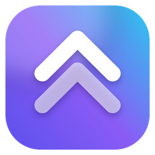

<h1 align="center">Launch Bay</h1>

A Windows app for starting your Roblox games and switching between your accounts in one place.

<a href="../../releases/latest"><b>⬇ Download Launch Bay</b></a>

> [!IMPORTANT]
> **Launch Bay is a shortcut. It does not replace or separate from the Roblox launcher.**
>
> Every game still opens through Roblox's own launcher and the official Roblox player, which you need to have installed. Launch Bay does not include, patch or modify Roblox's files.
>
> It is more than a shortcut in one way: it has optional extras (an auto clicker, auto walk, anti-AFK and running several Roblox windows at once) that interact with Roblox while it runs. All of them are off until you turn them on.
>
> **Launch Bay is an independent project. It is not affiliated with or endorsed by Roblox Corporation.** Roblox is a trademark of Roblox Corporation.

## What it does

**Launching**
- Keep your favourite games in one list and start one with a click.
- Search Roblox games and browse popular ones from inside the app.
- Group games and accounts into a "squad" and start them all together.

**Accounts and friends**
- Add several Roblox accounts. Each gets its own browser profile, so you log in once on Roblox's normal login page.
- See which friends are online or in a game, and join them.
- Read, accept, decline and send friend requests, and see game invites.

**Optional extras (all off by default)**
- **Multi-instance:** run several Roblox windows at the same time.
- **Auto clicker, auto walk and anti-AFK**
- **Auto-rejoin:** starts a game again when its Roblox window closes.
- **Window tools:** arrange Roblox windows in a grid.

## Install

You need Windows 10 or 11, the Roblox player, and Chrome, Brave or Edge for logging in to accounts.

1. Download the zip from the [Releases page](../../releases/latest).
2. Right-click it, choose **Extract All**, and keep the folder together.
3. Double-click `LaunchBay.exe`.

To remove it, delete the folder. Your saved data is in `%APPDATA%\LaunchBay`.

## Is this safe?

Launch Bay is a new app from a small developer, so it's fair to check first.

- **File fingerprint (SHA-256) of `LaunchBay-10.3-Windows.zip`:** `EDB636E25BD13494C0A7BAB739F0284436A6EB0A6705D0EC3B24FF59546F64A9`. To scan it yourself, upload the zip at [VirusTotal](https://www.virustotal.com).
- **Passwords:** you log in on Roblox's own page. Launch Bay doesn't read, save or send your password or login cookie.
- **Network:** it only talks to Roblox's websites and your own PC. It has no analytics or tracking.
- **Windows warning:** the app isn't code signed yet, so Windows may show "Windows protected your PC". Only continue if you got it from this page. Click **More info**, then **Run anyway**.
- **Antivirus:** some tools may flag it, because it can send clicks and work with Roblox's windows. Don't turn off your antivirus for it. If you're unsure, don't run it.
- **Source code:** the code isn't public, so you're trusting these notes and the scan results.

**How account features work:** Launch Bay opens that account's browser profile, usually hidden, with a debugging port that only this PC can reach. It runs small scripts on roblox.com, so requests go out as that logged-in account. Other programs on your PC could also reach that port while the browser is open. To link an account, it finds your Roblox user ID in that profile's files, and it edits the profile's settings once so roblox.com can open Roblox without asking each time. These profiles stay logged in, so keep `%APPDATA%\LaunchBay` private and never share it.

## Problems or ideas

Open an [issue](../../issues).

## Licence

All rights reserved. You can download and use Launch Bay for yourself, but you can't copy, share or sell it without permission. See [LICENSE](LICENSE). Included fonts have their own licences, listed in [FONT-LICENSES.txt](FONT-LICENSES.txt).
